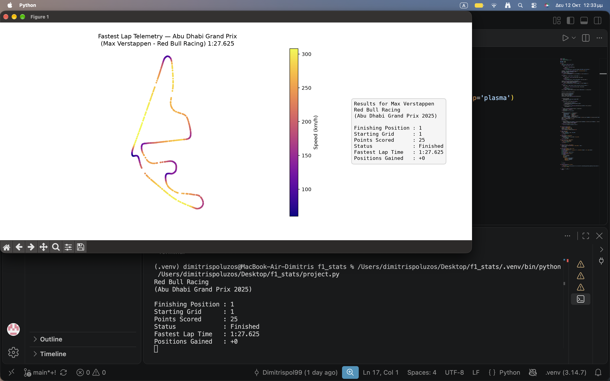

# F1 Race Result & Fastest Lap Explorer

#### Video Demo:

#### Description:

The script was created as a convenient tool to evaluate the performance of a driver in a particular race. The application is a command-line Python program. After launching the script, the user selects the desired year and race, then the desired driver, after which information about the race results appears on the screen in the terminal. In addition, a window with a track map of the fastest lap of the selected driver is opened.

## Features

The program includes the following functions:

1. Checking the correctness of the entered year.

2. Displaying a list of races in the selected year and displaying information about the selected race.

3. Displaying a list of participants in the selected race and the ability to select a driver.

4. Displaying information about the selected driver (final position, starting position, points, status, fastest lap, and positions gained or lost).

5. Displaying the fastest lap of the selected driver as a track map with colors indicating the car’s speed.

Each step has input validation built into it in the form of verification loops. In case of incorrect input, the user is shown a message describing the error and the selection is repeated. 

## Files

The files that make up the project are as follows:

The project.py file contains the main() function and all other functions used in the script, which are defined at the top level, at the same indentation level as main(), as the course requires.

- The main() function itself contains loops for receiving and validating user input, building a results panel based on the received data, and plotting the fastest lap.

- The parse_year(text) function is used to parse the year; it returns an integer or raises a ValueError if the text cannot be parsed correctly.

- Similarly, the parse_round(text, max_round) function parses the round number, comparing the input with the total number of rounds in the selected season.

- The parse_driver(text, valid_codes) function strips leading and trailing whitespace, converts it to uppercase, and compares it with the three-letter codes of the drivers participating in the selected race.

- The format_lap_time(seconds) function formats the time of the fastest lap by converting the total number of seconds into minutes and seconds.

- The positions_gained(grid, finish) function calculates the difference between the starting and finishing positions, which may indicate the number of places gained or, conversely, lost.

- The load_session(year, round_number) function loads the data for the selected race.

- The plot_track(telemetry, title, info) function displays the track map and the results panel.

The test_project.py file contains pytest tests for format_lap_time, parse_year, parse_round, parse_driver and positions_gained.

The requirements.txt file contains information about the libraries used in the project, namely: fastf1, matplotlib, pandas, pytest.

## Design choices

I show the races from the FastF1 schedule instead of asking the user to type a name, because I want to prevent typos and show the user exactly which inputs are valid.

The minimum year is 2018 because FastF1 provides lap stats from 2018 onwards.

In format_lap_time, a time like 119.9996 seconds printed as 1:60.000, because I split the time into minutes and seconds before rounding, so the seconds were rounded up to 60.000 afterwards. I fixed it by rounding the total seconds first, and a test now locks it in.

The cache makes later runs faster because the data for a race is downloaded only once and stored on disk. Later runs read it from there instead of downloading it again.

In this project I have separated the parsing logic from the main program flow. The parse_year(), parse_round(), and parse_driver() functions each have a clear responsibility: to validate and parse user input. This approach allows for cleaner code organization, as the main() function doesn’t get cluttered with complex parsing logic. Additionally, these functions can be easily tested in isolation, which was done using pytest.

## Edge cases

When creating the script, several challenges had to be addressed:

- Handling cases when a driver did not finish the race or did not complete enough laps to record a fastest lap. These edge cases are handled gracefully by the script, which informs the user instead of raising errors.

- A driver may have no valid lap time (NaT), so the script checks for it and skips the track map instead of crashing.

- Interpreting special cases, such as a driver starting from the pit lane, which affects their grid position and, consequently, the calculation of positions gained or lost.

## Testing

I am not testing the main() function, load_session(), and plot_track() because they require network connectivity and a graphical environment, which might not always be available. Therefore, the testing efforts were focused on the individual functions and unit-level operations rather than end-to-end tests.

## How to run

To use the script, one needs to install the required dependencies using pip:

pip install -r requirements.txt

Then the script can be launched by running:

python project.py

The first time the script is launched for a particular year, an internet connection will be needed to download the data; subsequent launches will use the cached data.
